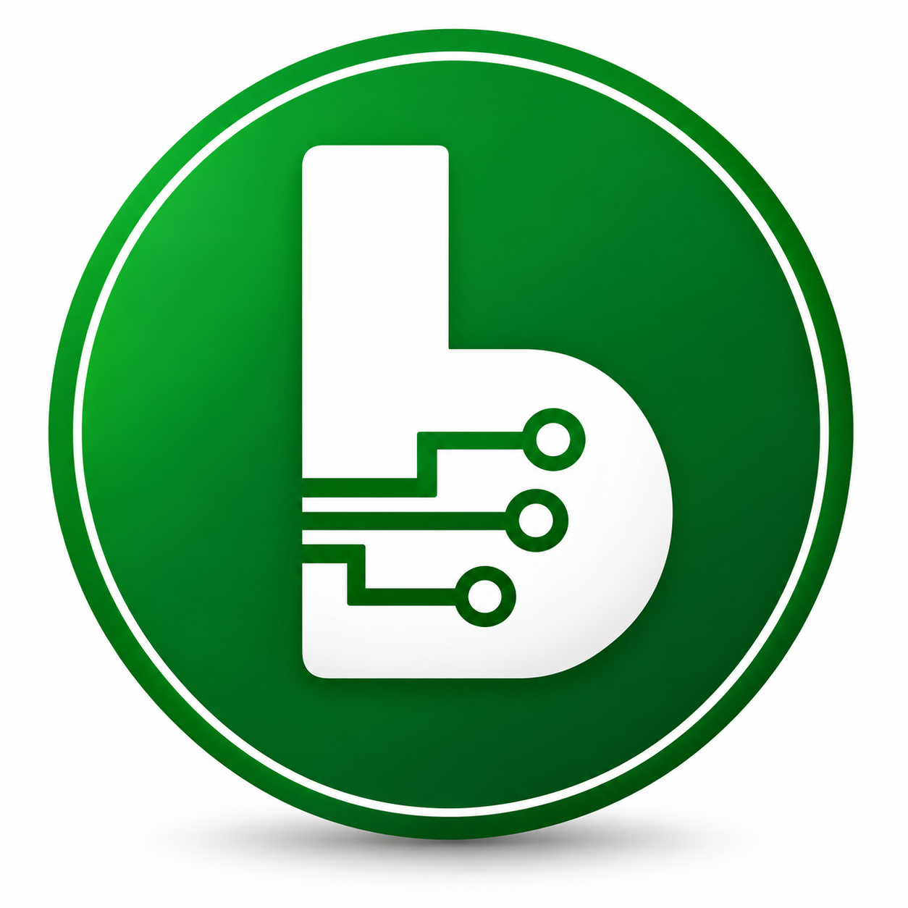

<div align="center">



# Barwaaqo Electronics

### Retail management workspace

Sales, inventory, customer credit, expenses, and supplier purchases.<br>
Explore the shop with fictional records and browser-local storage.

[Live home page](https://hafsaztudio.github.io/barwaaqo-electronics-demo/) · [Try the workspace](https://hafsaztudio.github.io/barwaaqo-electronics-demo/frontend/demo.html) · [Run locally](#run-locally) · [Project layout](#project-layout)

</div>

---

## Explore the shop

The home page introduces the workspace. Select **Open workspace** to try the shop workflows using sample products, customers, and suppliers.

| Workflow | Try it |
| --- | --- |
| **Point of sale** | Add products to the cart, complete a simulated sale, and view or print its receipt. |
| **Inventory** | Search products by name, SKU, or category and check low-stock items. |
| **Customer credit** | Charge a sample sale to a demo customer and record a repayment. |
| **Supplier purchases** | Create an order, receive it into stock, and record partial payments. |
| **Expenses** | Record a shop cost by category and payment method, or void an incorrect entry. |
| **End of day** | Compare collections, expenses, and supplier payments by payment method. |

This public version uses fictional names and seeded records. Changes stay in the current browser under the `barwaaqo-public-demo-v1` local storage key. Use **Reset workspace** in the sidebar to start again.

## Run locally

Use Node.js 22 or later. This project uses Node's built-in modules and browser JavaScript.

```sh
git clone https://github.com/hafsaZtudIO/barwaaqo-electronics-demo.git
cd barwaaqo-electronics-demo
npm start
```

Open [localhost on port 4173](http://127.0.0.1:4173). A dependency installation is optional because the app has zero npm dependencies.

## Verify and build

```sh
npm test
npm run build
```

The tests exercise stock checks, sale rollback, credit repayments, supplier overpayments, receipt replay protection, and expense totals. The build copies the public website and demo modules into `dist/` for static hosting.

For GitHub Pages, select **Deploy from a branch**, choose `main`, and select `/ (root)`. The root page opens the home page in `frontend/`.

## Project layout

```text
frontend/
  index.html          Public home page
  demo.html           Interactive workspace
  app.js              Screens, forms, and browser storage
  styles.css          Responsive website and workspace styles
  assets/             Sample product images
backend/
  demo-data.js        Fictional starting records
  demo-store.js       Stock, sales, payments, and expense rules
  server.js           Local static preview server
scripts/
  build.js            Static website packaging
tests/
  demo.test.js        Domain behavior tests
index.html            Home page entry point
package.json          Run, test, and build commands
```

## Demo scope

Payments are simulated. Orders are received in full. Dates use UTC, and amounts use USD integer cents. This public example runs entirely with fictional data and has no connection to the private shop workspace.

Use fictional descriptions when trying the forms. The demo keeps browser data until it is reset or cleared. Two tabs in the same browser share demo records, and browsers with Web Locks serialize simultaneous updates.

## Design

The interface uses larger DM Sans typography, warm neutral surfaces, and forest green accents. Font files load from Google Fonts, with local system fallbacks. Product images and the Barwaaqo logo ship with the website.
